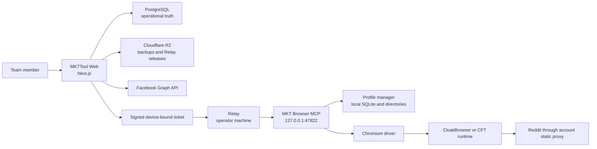
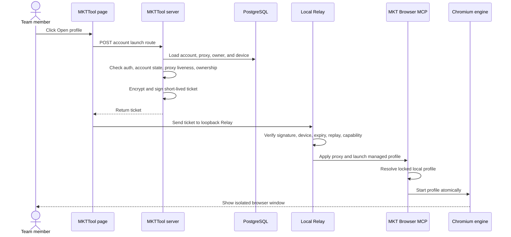

# Visual Explanation: MKTWorkspace Codebase

## Overview

MKTWorkspace contains two independent repositories that form one operational system:

- `MKTTool`: the team-facing web console, database, policy engine, schedulers, and local Relay.
- `MKTBrowser`: the desktop profile runtime that stores and launches isolated browser profiles.

The central design rule is that the hosted web server decides what is allowed, while sensitive
operator-side actions happen only on the assigned operator machine.

## Quick View

```text
 Team member
     |
     v
+----------------------+        PostgreSQL / R2 / APIs
| MKTTool Web          |------> accounts, jobs, rules,
| Next.js on Railway   |        audit, backup, Facebook
+----------+-----------+
           |
           | short-lived signed and device-bound ticket
           v
+----------------------+        loopback only
| Relay                |-------------------------------+
| Operator Windows PC  |                               |
+----------+-----------+                               v
           |                                  +----------------------+
           | decrypts ticket locally          | MKT Browser          |
           | and enforces capability           | Electron + MCP       |
           |                                  +----------+-----------+
           |                                             |
           +---------------------------------------------+
                                                         v
                                               isolated Chromium profile
                                               with its assigned proxy
```

## System Topology



## Repository 1: MKTTool

### Entry points

| Area | Responsibility | Main location |
|---|---|---|
| Pages | Dashboard and management screens | `MKTTool/src/app/` |
| API routes | Browser launch, OAuth, health runs, rule previews | `MKTTool/src/app/api/` |
| Page access | Authenticates page reads before rendering | `MKTTool/src/proxy.ts` |
| Startup work | Starts daily health and backup schedulers | `MKTTool/src/instrumentation.ts` |
| Shared UI | Forms, tables, alerts, queue widgets | `MKTTool/src/components/` |

Most Next.js pages are server components. They read PostgreSQL through Prisma and render HTML on the
server. Mutations use guarded server actions or guarded route handlers so authorization is checked at
the actual operation boundary, not only at page navigation.

### Business modules

`MKTTool/src/lib/` is organized by business responsibility:

| Module | What it owns |
|---|---|
| `accounts/` | Account lifecycle, ownership, readiness, vault edits |
| `auth/` | Google login, allowlist, actor and role checks |
| `queue/` | Content jobs, scheduling, post state, interactions |
| `rules/` | Pure posting-safety evaluators and verdicts |
| `health/` | Reddit visibility checks, karma snapshots, health conclusions |
| `facebook/` | OAuth, token lifecycle, Page publishing |
| `proxies/` | Proxy liveness and bandwidth checks |
| `crypto/` | Server/operator vault domains and encrypted fields |
| `tickets/` | Ticket signing, recipient encryption, expiry, replay contract |
| `relay/` | Browser-side client and Relay endpoint contracts |
| `backup/` | PostgreSQL backup and R2 storage |
| `schedule/` | Database-coordinated daily execution |

The database schema is in `MKTTool/prisma/schema.prisma`. It is the operational source of truth for
accounts, proxies, content, jobs, interactions, users, audit records, Facebook connections, health
checks, and registered Relay devices.

### Relay

`MKTTool/relay/` is a separate local program even though it lives in the MKTTool repository. It:

1. Listens only on the operator machine.
2. Verifies the server signature and ticket version.
3. Confirms that the ticket was encrypted for this exact device.
4. Rejects expired, replayed, revoked, or unauthorized work.
5. Decrypts operator secrets locally.
6. Calls the local MKT Browser MCP endpoint.

The hosted server never calls the desktop browser directly and does not need the operator vault key.

## Repository 2: MKTBrowser

MKTBrowser is a Yarn workspace monorepo:

| Workspace | Responsibility |
|---|---|
| `apps/desktop` | Electron process, renderer, IPC, engine lifecycle, packaging |
| `packages/types` | Shared contracts and runtime types |
| `packages/settings-store` | Local application settings |
| `packages/profile-manager` | SQLite profile records, directories, fingerprint data |
| `packages/mcp-server` | Authenticated local profile-management API |
| `packages/cdp-driver` | Controlled Chromium DevTools Protocol sessions |

The Electron main process wires these packages together in
`MKTBrowser/apps/desktop/src/main/index.ts`. The renderer is not trusted with Node access: sandboxing
and context isolation are enabled, and every IPC channel is classified before use.

MKT Browser owns local state under `%LOCALAPPDATA%\MKTTool\MKTBrowser\`. PostgreSQL knows which account
belongs to which machine and profile ID, but the profile database and browser data remain local to
that machine.

## Main Flow: Open a Reddit Profile



The important failure rule is: the profile must not open if its proxy cannot be applied with
certainty. This prevents an account from accidentally using the operator's home IP.

## Other Flows

### Facebook Page publishing

Facebook Page publishing does not use Relay or MKT Browser:

```text
MKTTool Web -> stored Page token -> Facebook Graph API -> published Page post
```

### Reddit health checking

Health checking observes Reddit from an independent observer proxy. It does not log into the account
profile. A parser failure becomes `ERROR`, never a false `HEALTHY` result.

### Daily operations

`MKTTool/src/instrumentation.ts` starts two background loops in the production Node process:

- daily account-health checks;
- daily database backups to R2.

Database locks coordinate execution so multiple application instances do not perform the same daily
work twice.

## Mental Model

Use these five rules when reading or changing the code:

1. PostgreSQL owns operational truth; local SQLite owns browser-profile state.
2. MKTTool Web authorizes; Relay verifies and decrypts; MKT Browser executes locally.
3. Server secrets and operator secrets belong to different vault domains.
4. One Reddit account maps to one static proxy and one antidetect profile.
5. Facebook Graph API and Reddit browser workflows are separate execution paths.

## Where to Start Reading

For a first pass, read in this order:

1. `MKTTool/docs/codebase-summary.md`
2. `MKTTool/prisma/schema.prisma`
3. `MKTTool/src/app/page.tsx`
4. `MKTTool/src/lib/rules/rules-engine.ts`
5. `MKTTool/src/app/api/accounts/[id]/launch/route.ts`
6. `MKTTool/relay/src/main.ts`
7. `MKTBrowser/apps/desktop/src/main/index.ts`
8. `MKTBrowser/packages/profile-manager/src/ProfileManager.ts`
9. `MKTBrowser/packages/mcp-server/src/server.ts`

That path moves from product concepts to data, ordinary web behavior, and finally the sensitive
cross-process browser-launch path.
